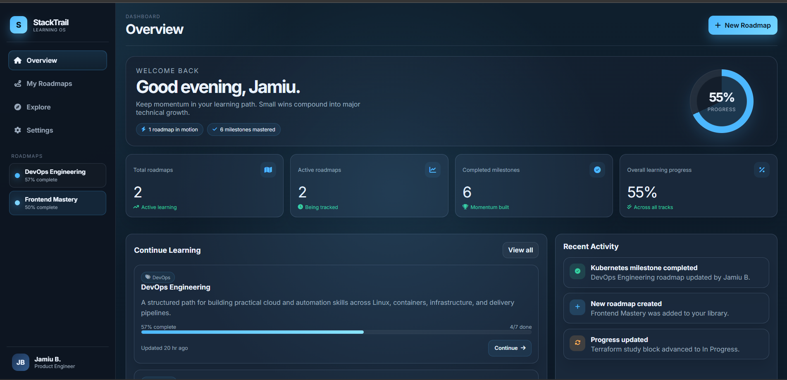

# StackTrail 🚀

**Build skills. Track progress. Keep moving.**

StackTrail is a technical learning roadmap and progress-tracking platform designed to help individuals organize their learning journeys, set technical goals, track milestones and monitor their progress.

Whether you're learning DevOps, Cloud Engineering, Frontend Development, Cybersecurity or Data Science, StackTrail helps you stay organized and accountable throughout your learning journey.

## 📸 Preview

<!-- Add your application screenshots here -->



## 🎯 Project Objectives

StackTrail is being developed as a practical DevOps learning project.

The primary objective is to build, containerize, automate and deploy a multi-container application while gaining hands-on experience with modern DevOps tools and cloud infrastructure.

Beyond the application itself, this project explores:

- Containerization with Docker.
- Multi-container orchestration with Docker Compose.
- Container networking and service communication.
- Database management and persistent storage.
- CI/CD automation with GitHub Actions.
- Cloud deployment using AWS.
- Infrastructure monitoring and troubleshooting.

## ✨ Features

### Current Development: Frontend

- Learning roadmap dashboard.
- Roadmap creation and management.
- Learning milestone tracking.
- Progress visualization.
- Responsive user interface.

Additional functionality will be documented as development progresses.

## 🛠️ Technology Stack

| Technology     | Purpose                                 |
| -------------- | --------------------------------------- |
| HTML5          | Frontend structure                      |
| CSS3           | Styling and responsive design           |
| JavaScript     | Frontend functionality                  |
| Python / Flask | Backend API (planned)                   |
| PostgreSQL     | Database (planned)                      |
| Docker         | Containerization (planned)              |
| Docker Compose | Multi-container orchestration (planned) |
| GitHub Actions | CI/CD automation (planned)              |
| AWS            | Cloud infrastructure (planned)          |

## 📁 Project Structure

```text
stacktrail/
│
├── frontend/
│   ├── index.html
│   ├── style.css
│   └── script.js
│
├── backend/
│
├── database/
│
├── .gitignore
└── README.md
```

_The structure will evolve as backend and infrastructure components are introduced._

## 🚀 Getting Started

### Prerequisites

- Git
- A modern web browser
- Visual Studio Code (recommended)

### Installation

1. Clone the repository:

```bash
git clone https://github.com/Confidenceb/StackTrail.git
```

2. Navigate into the project:

```bash
cd stacktrail
```

3. Open the `frontend` directory and run `index.html` using a local development server, such as the VS Code Live Server extension.

Alternatively, use Python:

```bash
cd frontend
python -m http.server 8000
```

4. Open your browser at:

```text
http://localhost:8000
```

## 🗺️ Development Roadmap

StackTrail will be developed in stages.

- [x] Frontend interface development.
- [ ] Backend API development using Flask.
- [ ] PostgreSQL database integration.
- [ ] API and database connectivity.
- [ ] Dockerize frontend and backend.
- [ ] Configure Docker Compose.
- [ ] Implement container networking.
- [ ] Configure persistent database storage.
- [ ] Add health checks and service dependencies.
- [ ] Implement automated testing.
- [ ] Build CI/CD pipelines with GitHub Actions.
- [ ] Publish container images to Amazon ECR.
- [ ] Deploy to AWS EC2.
- [ ] Implement monitoring and logging.
- [ ] Explore Kubernetes deployment.

## 🎓 Learning Outcomes

This project is intended to provide practical experience with:

- Building and managing multi-container applications.
- Understanding communication between application services.
- Managing containerized databases and persistent volumes.
- Automating software testing and image builds.
- Deploying applications to cloud infrastructure.
- Troubleshooting application and infrastructure failures.

## 🤝 Contributions

Suggestions, feedback and contributions are welcome.

## 📄 License

This project is licensed under the MIT License. See the `LICENSE` file for details.

---

**StackTrail — Build skills. Track progress. Keep moving.**
